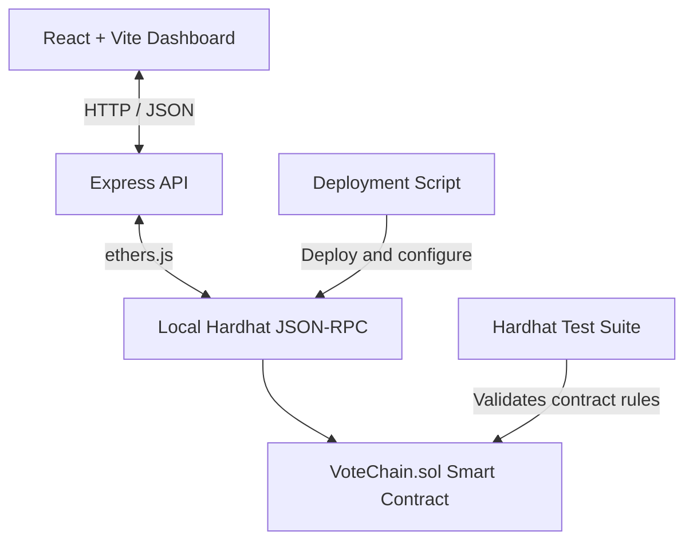

<div align="center">


# VoteChain

### Every vote recorded. Every result traceable.

**A transparent, smart-contract-powered voting platform built on a local Ethereum-compatible blockchain.**

<p>
  
  
  
  
</p>

[Features](#-features) · [Architecture](#-architecture) · [Getting Started](#-getting-started) · [Usage](#-using-votechain) · [Testing](#-testing) · [Security](#-security-notice)

</div>

---

## 🗳️ About VoteChain

VoteChain demonstrates how blockchain technology and smart contracts can support a clear, verifiable voting workflow. Votes are submitted as transactions to a local Ethereum-compatible blockchain, while contract rules enforce voter eligibility, prevent an account from voting more than once, and restrict voting to an active election.

The application brings the process together in a single dashboard: review candidates, cast a vote, inspect results, and explore the transaction history behind the count.

> **Designed for local demonstration and learning.** VoteChain is not a production election system and does not provide voter identity verification or secret ballots.

## ✨ Features

- **Election overview** — view the election status, candidates, vote totals, demo voters, and latest block.
- **Candidate management** — add candidates during the setup phase.
- **Guided ballot** — select a demo voter, choose a candidate, review the selection, and confirm the vote.
- **Smart-contract-enforced rules** — only eligible accounts can vote, each eligible account can vote once, and votes are accepted only while voting is open.
- **Live results** — view candidate vote counts and percentage breakdowns.
- **Transaction history** — inspect voter addresses, transaction hashes, block numbers, and timestamps.
- **Local network status** — view the local chain ID, latest block, and deployed contract details.
- **Election lifecycle controls** — start and finalize voting through local administrator endpoints.
- **Automated contract tests** — verify core election rules and expected rejections.
- **No external wallet required** — no MetaMask, public testnet, real cryptocurrency, or account registration is needed.

## 🧰 Technology Stack

| Layer | Technologies |
|---|---|
| Frontend | React 18, Vite 6, CSS |
| UI icons | Lucide React |
| Backend API | Node.js, Express |
| Blockchain interaction | ethers.js 6 |
| Smart contract | Solidity `0.8.24` |
| Local blockchain and deployment | Hardhat |
| Testing | Hardhat, Chai |
| Development orchestration | concurrently, wait-on |

## 🏗️ Architecture



### How a vote is recorded

1. A voter selects a demo account and a candidate in the web interface.
2. The frontend sends the vote request to the local Express API.
3. The API submits a transaction using the corresponding local development account.
4. `VoteChain.sol` checks that voting is open, the account is eligible, the account has not voted already, and the candidate ID is valid.
5. If all checks pass, the contract records the vote and emits a `VoteCast` event.
6. The dashboard refreshes its results and transaction history from the local chain.

## 🚀 Getting Started

### Prerequisites

- **Node.js 20 LTS or newer**
- **npm** (included with Node.js)
- Git (optional, if cloning the repository)
- A modern web browser

### 1. Get the source code

Download and extract the repository ZIP, or clone the repository:

```bash
git clone <your-repository-url>
cd VoteChain-main
```

If you downloaded the ZIP, open the extracted `VoteChain-main` directory in your terminal.

### 2. Install dependencies

```bash
npm install
```

### 3. Start the complete local environment

```bash
npm run dev
```

This command starts the following processes together:

1. A local Hardhat blockchain on `127.0.0.1:8545`
2. The deployment script, which deploys and configures the smart contract
3. The Express API on `127.0.0.1:3001`
4. The Vite frontend on `127.0.0.1:5173`

The deployment script creates a sample election, adds three sample candidates, configures six eligible demo voter accounts, and starts voting.

### 4. Open VoteChain

Visit **http://127.0.0.1:5173** in your browser.

Keep the terminal running while using the application. To stop the environment, press `Ctrl+C` in the terminal running `npm run dev`.

> **Local-chain reset:** the development blockchain is temporary. Restarting the local node creates a fresh chain and resets the election state and transaction history.

## 🧭 Using VoteChain

### Explore the dashboard

Use the sidebar to move between:

- **Overview** — election status and summary statistics.
- **Cast a vote** — select a demo voter, choose a candidate, review, and confirm.
- **Candidates** — review candidates and add candidates during setup.
- **Results** — inspect the current vote count and percentages.
- **Transactions** — review confirmed vote transactions and search the history.

### Cast a demo vote

1. Open **Cast a vote**.
2. Select an eligible demo voter account.
3. Choose a candidate.
4. Review the selection and confirm.
5. Open **Results** to see the updated count.
6. Open **Transactions** to inspect the transaction hash, block number, voter address, and timestamp.
7. Try voting again with the same account to see the contract reject a duplicate vote.

The included deployment script starts the election automatically. Candidate and voter-eligibility changes must be made before voting starts.

### Start or finalize an election

With VoteChain running, open a **second terminal** in the project directory.

Start voting:

```bash
curl -X POST http://127.0.0.1:3001/api/admin/start
```

End and finalize voting:

```bash
curl -X POST http://127.0.0.1:3001/api/admin/end
```

These endpoints submit transactions to the local smart contract. Only the first local Hardhat account is authorized as the administrator. Since the default deployment starts voting automatically, the start endpoint is primarily useful when testing a deployment configured to remain in setup mode.

See [`LOCAL-ADMIN.md`](LOCAL-ADMIN.md) for the concise administrator reference.

## 🧪 Testing

Run the smart-contract test suite:

```bash
npm test
```

The tests cover the contract's core behavior, including candidate setup, the minimum candidate requirement, valid voting, duplicate-vote prevention, ineligible accounts, and closed elections.

Create a production frontend build:

```bash
npm run build
```

## 📁 Project Structure

```text
VoteChain-main/
├── contracts/
│   └── VoteChain.sol          # Election smart contract
├── scripts/
│   └── deploy.js              # Deploys and configures the local election
├── test/
│   └── VoteChain.test.js      # Smart-contract tests
├── public/
│   └── favicon.svg            # VoteChain logo / favicon
├── src/
│   ├── App.jsx                # Main application and pages
│   ├── main.jsx               # React entry point
│   └── styles.css             # Application styling
├── server.js                  # Local Express API and transaction handling
├── index.html                 # Vite HTML entry point and page metadata
├── hardhat.config.js           # Solidity, network, and test configuration
├── package.json                # Dependencies and npm scripts
├── LOCAL-ADMIN.md              # Local election administration reference
├── LICENSE                     # MIT License
└── README.md                   # Project documentation
```

## 🔌 Local API Reference

The Express API listens on `http://127.0.0.1:3001` by default.

| Method | Endpoint | Purpose |
|---|---|---|
| `GET` | `/api/health` | Check local blockchain connectivity, chain ID, and latest block |
| `GET` | `/api/state` | Read election state, candidates, voters, and contract details |
| `GET` | `/api/history` | Retrieve vote transaction history |
| `POST` | `/api/vote` | Submit a vote for a demo voter and candidate |
| `POST` | `/api/admin/candidate` | Add a candidate before voting begins |
| `POST` | `/api/admin/start` | Start voting |
| `POST` | `/api/admin/end` | End and finalize voting |

The API is intended for local development only. Do not expose these endpoints publicly.

## 🔐 Security Notice

VoteChain is a demonstration application, **not a secure or production-ready election platform**. Keep the following limitations in mind:

- **Demo accounts only:** the voter selector is not identity verification. Anyone with access to the app can select a demo account.
- **No secret ballots:** voter addresses and vote transactions are visible on the local blockchain. The contract does not provide ballot secrecy.
- **Development keys only:** Hardhat's well-known local accounts and keys are for development. Never use them with real funds or real elections.
- **Local API only:** the API is designed to bind to `127.0.0.1`. Do not expose it to the public internet or deploy it with development signing keys.
- **Temporary chain:** local chain data is not persistent across a node reset.
- **Not independently audited:** the contract and application have not been presented as a security-audited election system.

A real deployment would require a different security architecture, robust voter authentication and eligibility management, privacy-preserving ballot design, secure key management, independent audits, and appropriate legal and operational review.

## 🌐 Deployment

The included configuration is designed for a **local full-stack environment**. Hosting only the frontend will not provide access to a visitor's local blockchain or local API.

Do not deploy the bundled API or development signing keys to a public hosting provider. A public deployment would need a separately designed transaction-signing flow and a blockchain network accessible to the intended users.

## 📜 License

VoteChain is distributed under the **MIT License**. See [`LICENSE`](LICENSE) for the full license text.

---

<div align="center">

**VoteChain** · Transparent by design. Verifiable by the chain.

<sub>Built with React, Solidity, Hardhat, and ethers.js.</sub>

</div>
